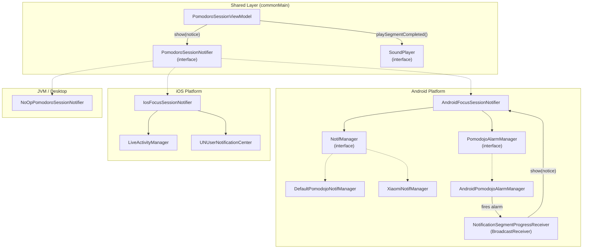
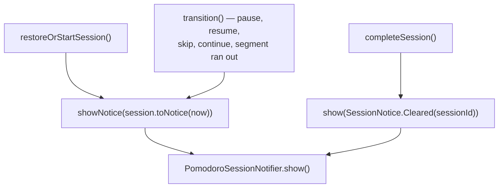
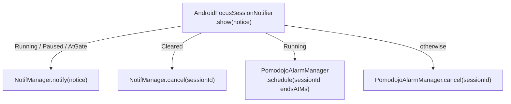
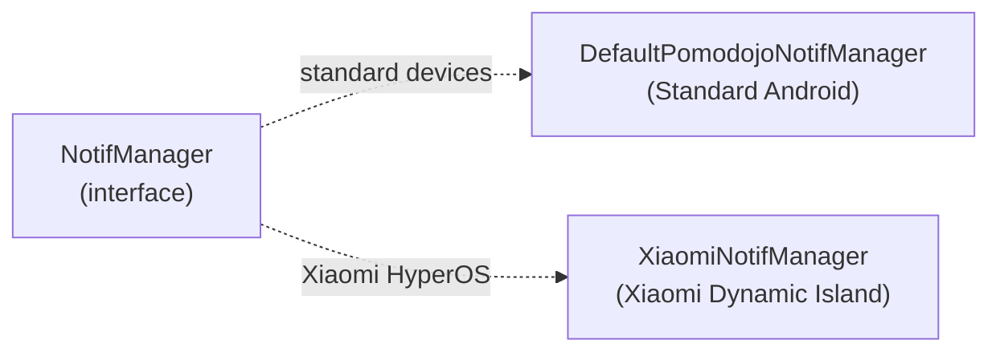
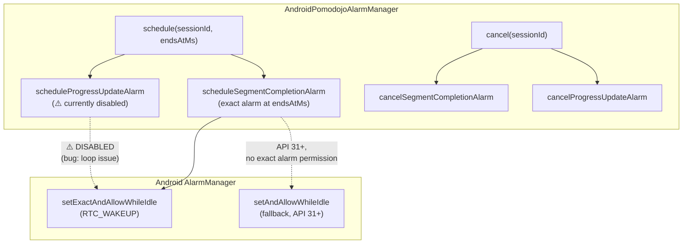
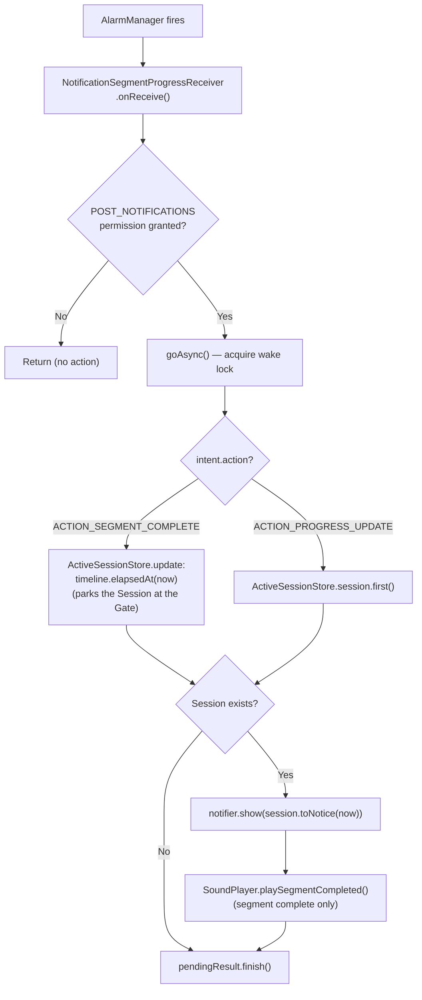
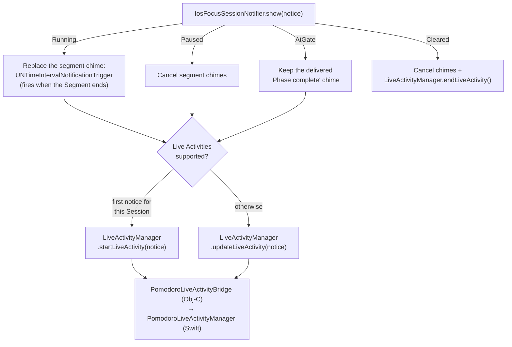
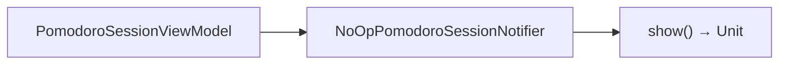
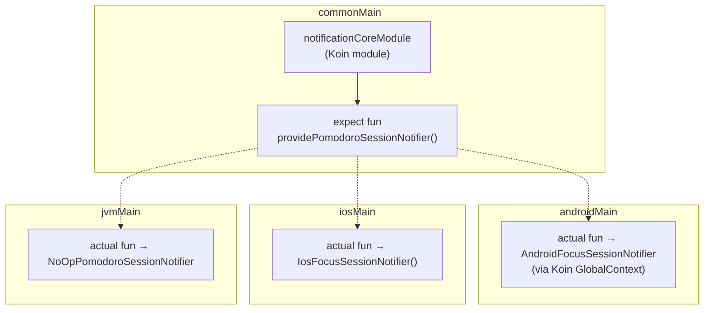

# Notification & Alarm Architecture

This document describes how PomoDojo handles notifications and alarms across platforms. The flow
starts from `PomodoroSessionViewModel` in the shared layer and branches into platform-specific
implementations via the `PomodoroSessionNotifier` interface.

---

## High-Level Overview

---

## ViewModel → Notifier Flow

`PomodoroSessionNotifier` has one method, **`show(notice: SessionNotice)`**. A `SessionNotice` is
the Session projected at one moment by `PomodoroSessionDomain.toNotice(now)` in `domain/pomodoro`:

| Notice    | When                                         | Carries                                    |
|-----------|----------------------------------------------|--------------------------------------------|
| `Running` | A Segment is counting down                   | Segment, remaining time, **`endsAtMs`**    |
| `Paused`  | A Segment is paused                          | Segment, remaining time                    |
| `AtGate`  | A Segment ran out; the next waits (the Gate) | Finished Segment, next Segment             |
| `Cleared` | Not started, complete, or finished          | Session id only                            |

Adapters only render the notice. They arm their alarm or chime from `Running.endsAtMs` and
cancel it for every other notice; no status rules or clock reads live in the adapters.

A plain tick (only the clock moved) shows nothing new: the platform countdowns run on their own
from `endsAtMs`.

---

## Android Platform

### Architecture

Titles and status lines come from `SessionNoticeText.kt` (Android string resources).

### NotifManager Implementations

There are two `NotifManager` implementations, selected based on device manufacturer:

#### DefaultPomodojoNotifManager

- Creates a notification channel (`focus_session_channel`).
- Displays an **ongoing, silent notification** with:
    - Progress bar (`progressPercent()`; full at the Gate).
    - Chronometer countdown while running, using `setWhen(endsAtMs)`.
    - BigTextStyle with the motivational quote, or "Tap to continue" at the Gate.
- Uses `PRIORITY_MAX` for persistent visibility.

#### XiaomiNotifManager

- Uses `HyperIslandNotification.Builder` for **Xiaomi Dynamic Island** integration.
- While running, sends a countdown via `TimerInfo` and `setBigIslandCountdown(endsAtMs)`.
- Paused or at the Gate, shows static text instead (e.g. "12:00 remaining • Paused").
- Wraps notification extras with `miui.focus.param` JSON payload.

### Alarm Manager (Android)

> **Note:** Progress update alarms are currently **disabled** (commented out in
> `AndroidPomodojoAlarmManager`) due to a known bug where they loop the notification update
> continuously.

### Broadcast Receiver Flow

When the alarm fires, `NotificationSegmentProgressReceiver` handles the intent:

The receiver never starts the next Segment or finishes the Session: it only parks the Session at
the Gate, and the foreground finishes it (see `docs/adr/0001-background-alarm-only-parks-session.md`).
The update is atomic, so it cannot overwrite a change the app made at the same moment. When the
last Segment runs out the notice is `Cleared`, so no stale "00:00" notification is left behind.

### Android Request Code Scheme

| Purpose                    | Formula                                |
|----------------------------|----------------------------------------|
| Session notification ID    | `42_000 + sessionId.hashCode()`        |
| Segment completion alarm   | `42_000 + 1000 + sessionId.hashCode()` |
| Progress update alarm      | `42_000 + 2000 + sessionId.hashCode()` |
| Xiaomi Dynamic Island ID   | `42_000 + 4000 + sessionId.hashCode()` |

---

## iOS Platform

### Show Flow

The bridge passes `endsAtEpochMs` (0 unless running) and `nextSegmentType` (set only at the
Gate). The widget counts down to `endsAtEpochMs`; at the Gate it shows the finished Segment at
00:00 with "Break next — tap to continue". If a Live Activity for the same Session already exists
(e.g. after the app was relaunched), the Swift side updates it instead of starting a second one.

### iOS Segment Completion Chime

Unlike Android's `AlarmManager`, iOS schedules a **local notification** that fires when the
running Segment ends (`UNTimeIntervalNotificationTrigger` with the notice's remaining time). It
plays `timer_notification.wav` and says "Phase complete — tap to continue".

---

## JVM / Desktop

The JVM (Desktop) platform uses `NoOpPomodoroSessionNotifier`, which does nothing:

---

## DI Wiring

Dependency injection is handled via Koin with `expect/actual`:

---

## Key Files Reference

| Layer   | File                                     | Purpose                                  |
|---------|------------------------------------------|------------------------------------------|
| Domain  | `SessionNotice.kt`                       | `SessionNotice` + `toNotice(now)`        |
| Common  | `PomodoroSessionNotifier.kt`             | Interface: `show(notice)`                |
| Common  | `SoundPlayer.kt`                         | Interface for segment completion audio   |
| Common  | `NotificationFeatureModules.kt`          | Koin DI wiring                           |
| Common  | `PomodoroSessionNotificationProvider.kt` | `expect fun` provider                    |
| Android | `AndroidFocusSessionNotifier.kt`         | Orchestrates notification + alarm        |
| Android | `NotifManager.kt`                        | Notification display interface           |
| Android | `DefaultPomodojoNotifManager.kt`         | Standard Android notification            |
| Android | `XiaomiNotifManager.kt`                  | Xiaomi Dynamic Island notification       |
| Android | `PomodojoAlarmManager.kt`                | Alarm scheduling interface               |
| Android | `AndroidPomodojoAlarmManager.kt`         | Exact alarm scheduling                   |
| Android | `NotificationSegmentProgressReceiver.kt` | BroadcastReceiver for alarm intents      |
| Android | `SessionNoticeText.kt`                   | Notice → Android title / status text     |
| iOS     | `IosFocusSessionNotifier.kt`             | Live Activity + local notifications      |
| iOS     | `LiveActivityManager.kt`                 | Kotlin wrapper for Swift bridge          |
| JVM     | `PomodoroSessionNotifier.jvm.kt`         | No-op implementation                     |
| Feature | `PomodoroSessionViewModel.kt`            | Calls `show()`                           |

---

## Known Issues

> ⚠️ **Progress Update Alarm Loop Bug**
>
> The `scheduleProgressUpdateAlarm()` in `AndroidPomodojoAlarmManager` is **currently disabled**
> (commented out). When enabled, it creates an infinite loop where each alarm trigger re-schedules
> itself, causing continuous notification updates. The alarm fires → receiver calls
> `notifier.show()` → which calls `alarmManager.schedule()` → which schedules another alarm →
> repeat.
>
> **TODO:** Re-draw the flowchart diagram of notification and alarm triggers to identify the
> correct fix. See comment in `AndroidPomodojoAlarmManager.kt:86-87`.
